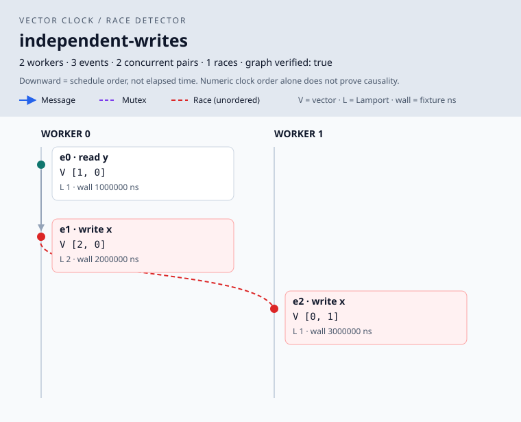

# vector-clock-race-detector

A deterministic Go simulator that demonstrates distributed causality and detects
conflicting memory accesses using vector clocks. Every history is independently
checked against an explicitly constructed happens-before graph.

**Different timestamps do not prove causality.** Two writes may happen milliseconds
apart in a fixture and still be causally unordered. Lamport clocks preserve causal
ordering in one direction; vector clocks also identify incomparable events.



## Quick start

Requires **Go 1.22 or newer**. Uses only the standard library; no services or frontend build.

```sh
go run ./cmd/vcrace list
go run ./cmd/vcrace run --scenario independent-writes --out artifacts/demo
go run ./cmd/vcrace run --input examples/message-passing.json --out artifacts/message
go run ./cmd/vcrace verify --seed 42 --cases 1000 --max-events 30
go test ./...
```

Open `artifacts/demo/diagram.svg` in a browser. Each `run` writes:

| File | Contents |
| --- | --- |
| `trace.json` | Events with all three timestamps, clock and synchronization metrics |
| `report.json` | Race pairs, all event-pair comparisons, detector metrics, verification status |
| `diagram.svg` | Standalone space-time diagram with causal arrows and race connectors |

Existing output files are replaced, except when doing so would overwrite the input
fixture. Invalid histories fail before creating output.
Races are findings (exit code 0); invalid input, verification disagreement, and I/O
failures return exit code 1. Use `run --help` or `verify --help` for flags.

Build a binary with `go build -o artifacts/vcrace ./cmd/vcrace` (use `vcrace.exe` on Windows).

## Scenarios

| Scenario | Race pairs | Lesson |
| --- | ---: | --- |
| `independent-writes` | 1 | Increasing wall times do not order independent writes |
| `synchronized-writes` | 0 | A shared mutex propagates causal knowledge |
| `message-passing` | 0 | Write → send → receive → read establishes an order |
| `early-send` | 1 | Sending before a write does not order it with a remote read |
| `misleading-wall-clock` | 0 | Physical timestamps can run backward along a causal chain |
| `different-mutexes` | 1 | Separate mutexes do not order accesses to the same location |
| `concurrent-reads` | 0 | Concurrent reads do not conflict |
| `transitive-chain` | 0 | Causal knowledge propagates through three workers |

In `independent-writes`, the writes have vectors `[2, 0]` and `[0, 1]`. Neither is
componentwise less than the other, so they race. Their physical timestamps are
2 ms and 3 ms; their Lamport timestamps are 2 and 1. Neither scalar comparison
establishes causality.

The JSON examples demonstrate clock skew and mixed synchronization with four
workers. `examples/four-workers.json` reports three race pairs involving worker 3.

## Execution and fixtures

Workers are state machines, not goroutines. A single loop executes `operations`
in order. Each worker's subsequence defines its program order. The interleaving
between unrelated workers adds **no** happens-before edges. Physical timestamps
never select, delay, or reorder operations.

```json
{
  "name": "independent",
  "workers": 2,
  "operations": [
    {"id": "a", "worker": 0, "kind": "write", "resource": "x", "wall_ns": 1000},
    {"id": "b", "worker": 1, "kind": "read", "resource": "x", "wall_ns": -1000}
  ]
}
```

- There must be 2–4 workers, identified by zero-based indices. Event IDs are nonempty and unique.
- `read`, `write`, `acquire`, and `release` require `resource` and no `message`.
- `send` and `receive` require `message` and no `resource`.
- Each message ID has one send and at most one receive on another worker. A receive requires an earlier send. Messages are asynchronous; this does not model Go channels.
- Acquire requires an unlocked mutex; release requires ownership. Invalid or blocked schedules fail instead of being rescheduled.
- `wall_ns` is a signed 64-bit fixture value (default zero). Ties, negative offsets, and reversals are allowed.
- Histories are finite prefixes: empty histories, unreceived messages and mutexes still held at the end are allowed.
- Memory and mutex names have separate namespaces. A read does not create a synchronization edge.
- Unknown JSON fields and extra JSON values are rejected. CLI limits are 2 MiB per fixture and 1,000 events per history because reports and reachability use quadratic space.

Memory accesses are abstract events on named locations. This does not execute
memory values, resolve aliases, or instrument application code.

## Clock rules

All three strategies run over the same history and are recorded together.
Logical clocks start at zero. Each event increments its worker's Lamport clock
and its own vector component exactly once.

| Operation | Before increment | After increment |
| --- | --- | --- |
| Read / write | No merge | Record snapshot |
| Send | No merge | Publish snapshot in the message |
| Receive | Merge message timestamp | Record snapshot |
| Acquire | Merge mutex's last release (initially zero) | Record snapshot |
| Release | No merge | Publish snapshot in the mutex |

Lamport merge takes the scalar maximum; vector merge takes componentwise maxima.
Snapshots are copied so future increments cannot change earlier timestamps.

```text
a < b  iff every a[i] <= b[i], and at least one a[i] < b[i]
```

Comparison returns `before`, `after`, `equal`, or `concurrent`. Distinct valid
events cannot have equal vectors. Scalar/physical comparisons are explicitly
labeled **numeric order** in the report; they are not race detectors.

## Detection and independent verification

The detector retains all accesses per location. It compares accesses from
different workers when at least one is a write. Incomparable vectors identify
a race. Every conflicting unordered pair is reported once; read/read pairs do
not race. Retaining all accesses avoids a last-write-only approximation that
could miss earlier conflicts.

The oracle constructs a directed graph from the original operations:

1. Consecutive events on each worker.
2. Matching send → receive pairs.
3. Previous release → next acquire of each mutex.

An iterative DFS from each event computes reachability. Graph construction and
graph-based race enumeration do not use vector clocks or the detector's access
history. The checker asserts exact agreement on every pair's ordering, the
entire race set and concurrent-pair count. It also checks the Lamport invariant
along causal paths. Verification runs before artifacts are written.

This verifies bounded histories against an independent model; it is not a proof
for arbitrary programs or a replacement for Go's runtime race detector. The
model excludes goroutine lifecycle, atomics, condition variables, detailed
memory-model behavior, and real networking.

## SVG and metrics

Vertical position means **schedule step**, not physical time. Gray arrows show
program order, blue arrows show messages, purple dashed arrows show mutex
synchronization, and red dashed connectors mark races. Labels include all three
timestamps. Hover over events or edges for full labels. Only direct graph edges
are drawn; transitive relationships remain available through pair comparisons.

| Metric | Definition |
| --- | --- |
| Physical assignments | One copied fixture timestamp per event |
| Lamport / vector increments | One per event for each logical strategy |
| Lamport / vector merges | One per receive/acquire, including initial-zero mutex merges |
| Vector component operations | One per local increment plus one max per component per merge; excludes comparisons and copying |
| Synchronization events | Counts of sends, receives, acquires and releases |
| Concurrent event pairs | Unordered pairs of distinct events, including non-memory events |
| Detected races | Conflicting unordered memory-access pairs |
| Detector causal comparisons | Vector comparisons of candidate conflicting accesses |
| All-pair causal comparisons | One comparison per pair in the explanatory report |
| Detector runtime | Access indexing and race detection only; excludes simulation, pair analysis, oracle, rendering and I/O |

Trace and SVG are deterministic. Report content is deterministic except
`detector_runtime_ns`; tiny histories can measure 0 ns at the host timer's resolution.

For `E` events and `W` workers, clock maintenance costs `O(E × W)` in the worst
case. Detection and pair analysis cost `O(E² × W)`. With `S` direct graph edges,
the oracle takes `O(E × (E + S))` time and `O(E²)` reachability space. Pair reports
and SVG race overlays can also grow quadratically. This is intended for small,
inspectable histories.

## Validation and development

```sh
go test ./...
go vet ./...
go run ./cmd/vcrace verify --seed 42 --cases 1000 --max-events 30
go test ./internal/scenario -fuzz=FuzzGraphAgreement -fuzztime=10s
go test ./internal/scenario '-bench=.' -benchmem
```

Tests cover hand-calculated clocks, immutable snapshots, invalid schedules,
all eight scenarios, corrupted verifier inputs, fixture parsing, SVG escaping,
reproducible artifacts, and 500 seeded histories. Fuzzing varies seed, worker
count, and history length. The benchmark measures detection **and** explanatory
pair analysis; the report's timer measures detection alone.

`verify` cycles worker counts through 2–4 and lengths through 0–`max-events`,
using a fresh seed per history. The generator chooses enabled operations and
produces ties and skewed wall clocks. Verification failures include seed, worker
count and length for reproduction. Random checks are not exhaustive exploration.

```text
cmd/vcrace/          CLI, JSON input and artifact output
internal/clock/     Manual vector and Lamport arithmetic
internal/model/     Shared operation, trace and report types
internal/simulator/ Deterministic execution and synchronization state
internal/detector/  Vector race detection and pair analysis
internal/verify/    Independent graph construction and reachability
internal/scenario/  Built-in examples and seeded generation
internal/render/    Standard-library SVG generation
examples/           Editable JSON fixtures
docs/               Generated example diagram
```

## Background

- [Lamport, Time, Clocks, and the Ordering of Events in a Distributed System](https://www.microsoft.com/en-us/research/publication/time-clocks-ordering-events-distributed-system/)
- [The Go memory model](https://go.dev/ref/mem), especially synchronization and mutex ordering

Unlike a Chandy–Lamport snapshot simulator, this investigates causal ordering
and race detection rather than capturing a consistent global state.
